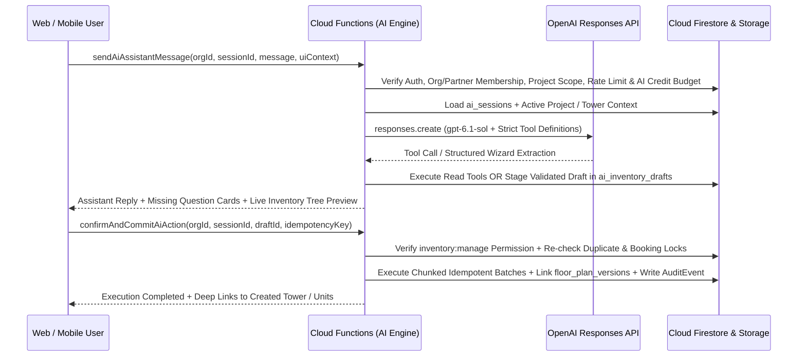

# Bharat Makaan — Internal AI Assistant Architecture

## 1. Architectural Principles

1. **Zero Direct AI Writes**: Model outputs are untrusted proposals. Every mutation flows through typed Zod schemas into staged drafts (`ai_inventory_drafts`), undergoes deterministic conflict & permission checks against Cloud Firestore, and executes only after explicit authenticated user confirmation via chunked, resumable, idempotent import jobs (`ai_import_jobs`).
2. **Server-Only OpenAI Responses API**: Frontend web and React Native mobile apps never hold OpenAI credentials or invoke OpenAI directly. All orchestration runs inside Firebase Cloud Functions v2 (`functions/src/ai/`) using the official `openai` SDK's **Responses API** (`client.responses.create`) with strict function calling and JSON Schema Structured Outputs.
3. **Configurable Model Routing & Account Validation**:
   - `OPENAI_MODEL_ORCHESTRATOR` (default: `gpt-6.1-sol`) — Main multi-turn conversational orchestration and tool selection.
   - `OPENAI_MODEL_VISION_FLOORPLAN` (default: `gpt-6.1-terra`) — Multimodal floor-plan, architectural PDF, and unit layout extraction.
   - `OPENAI_MODEL_ESCALATION` (default: `gpt-6-astra`) — Complex multi-page tower schedules and ambiguous layout reconciliation.
   - `OPENAI_MODEL_CLASSIFIER` (default: `gpt-6-luna`) — Low-latency intent classification and slot extraction.
   - Backend validates configured model availability against the active OpenAI account (`client.models.retrieve` / `client.models.list`) and logs actual model telemetry in `ai_usage_logs`.
4. **Reuse Canonical Domain Services**: Committed inventory, phases, towers, floors, units, floor-plan mappings, parking slots, draft price books, and cost-sheet templates reuse the exact domain invariants, status machines, and audit ledger (`audit_events`) used across the rest of Bharat Makaan.

---

## 2. Data Model (Firestore Collections)

### `ai_sessions/{sessionId}`
Tenant-, project-, and user-scoped conversational workspace:
- `orgId`: Owning builder/agency organization ID (or authorized builder ID for partner sessions).
- `projectId`: Active project scope (`null` when operating across multiple authorized projects).
- `uid`, `actorRole`, `partnerOrgId`: Authenticated user identity and role context.
- `contextSnapshot`: Current UI route, active project, selected tower, and selected unit.
- `activeWizard`: Active progressive wizard (`ADD_PROJECT`, `ADD_PHASE`, `ADD_TOWER`, `ADD_FLOOR_RANGE`, `ADD_UNITS`, `UNIT_NUMBERING`, `UNIT_TYPES`, `ASSIGN_FLOOR_PLAN`, `CREATE_PARKING`, `CREATE_PRICE_BOOK_DRAFT`, `CREATE_QUOTATION_TEMPLATE`, `SEARCH_INVENTORY`, `CREATE_FOLLOW_UP`, `SUMMARIZE_LEADS`, or `NONE`).
- `collectedAnswers`: Progressive slot map updated across turns with natural correction support.
- `missingFields`: Ordered list of unanswered mandatory fields (never re-asking facts already known from project config or earlier turns).
- `draftId`: Linked `ai_inventory_drafts` document ID when a write proposal is staged.
- `uploadedDocumentIds`: Linked `documents` IDs uploaded in this session.
- `proposedActions`, `validationErrors`, `confirmationState`, `executionJobId`, `messages`.

### `ai_inventory_drafts/{draftId}`
Staged, editable, non-destructive proposal prior to database commit:
- Supports `APARTMENT`, `VILLA`, `PLOT`, and `COMMERCIAL` structures, plus `PARKING_BATCH`, `PRICE_BOOK_DRAFT`, and `COST_SHEET_TEMPLATE_DRAFT`.
- Stores `towerSpec`, `floorTemplates` (handling ground lobbies, stilt/podium/basement levels, skipped/refuge floors, typical repeating floors, and exceptional penthouse/lower floors), `extractedFieldsProvenance`, and `generatedPreview` (`towersToCreate`, `floorsToCreate`, `unitsToCreate`, `unitsToUpdate`, `documentsToLink`, `duplicateConflicts`, `missingInformation`, `warnings`).
- Cancelled or rejected drafts remain marked `CANCELLED` without creating any production `towers`, `floors`, or `units`.

### `ai_import_jobs/{jobId}`
Chunked, checkpointed, idempotent execution tracker:
- Commits large multi-floor towers (`<= 200` Firestore operations per batch) using deterministic document IDs derived from `(draftId, entityKey)` so network retries or resumed jobs never create duplicate towers, floors, or units.
- Protects `BOOKED`, `AGREEMENT`, and `REGISTERED` units from silent modification and recalculates `projects/{projectId}.stats` accurately from persisted records.

---

## 3. End-to-End Request Lifecycle

