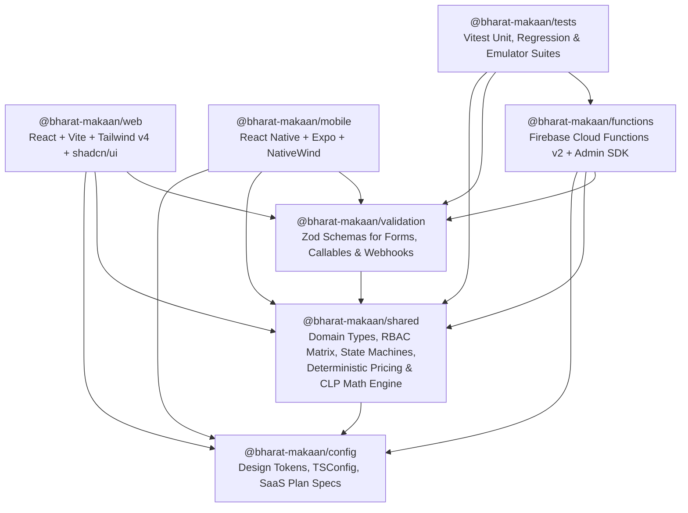
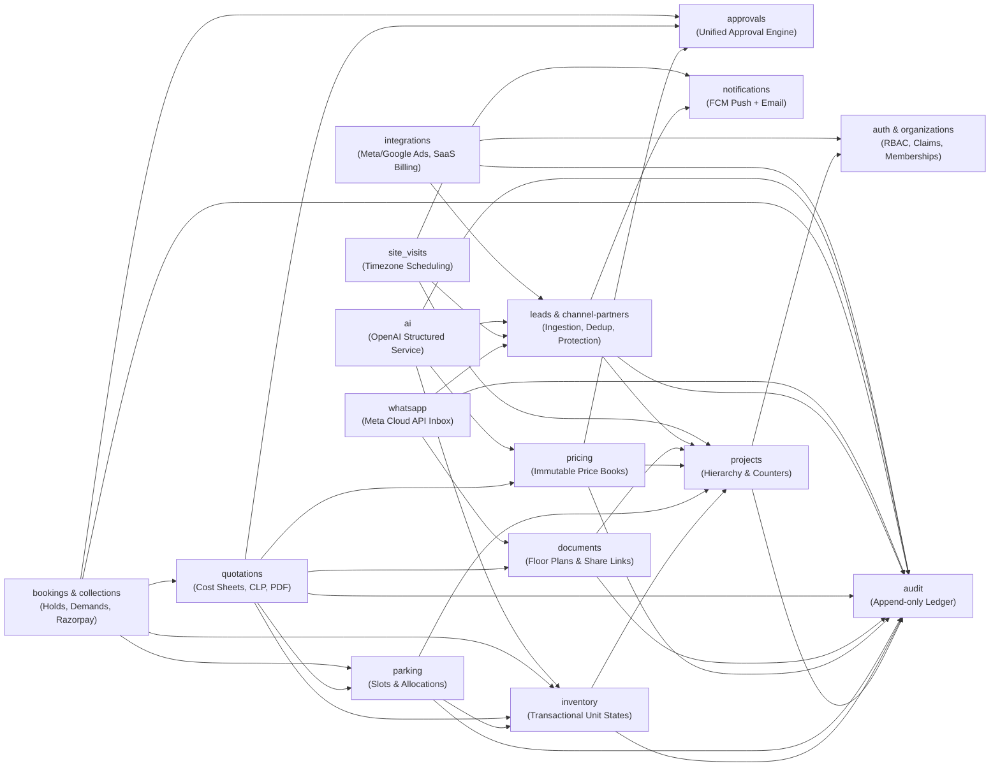

# Bharat Makaan Enterprise — Dependency Map

## 1. Workspace Package Dependency Graph

### Dependency Rules
- `packages/config` has **zero** runtime dependencies.
- `packages/shared` depends only on `@bharat-makaan/config` (pure TypeScript—runs identically in browser, React Native Hermes, and Node 22 Cloud Functions).
- `packages/validation` depends only on `zod` and `@bharat-makaan/shared`.
- Neither `apps/web` nor `apps/mobile` may import from `functions` or `firebase-admin`.
- `apps/mobile` never imports DOM/browser-bound `shadcn/ui` or `@radix-ui/*` modules.

---

## 2. Backend Domain Module Dependency Graph

---

## 3. Milestone Execution Dependency Order

1. **Phase 1 (Foundation)** → Prerequisite for all modules (Auth, Org Context, RBAC, Design System, Firestore Rules).
2. **Phase 2 (Enterprise Core)** → Depends on Phase 1; provides `projects`, `towers`, `floors`, `units`, and `parking_slots`.
3. **Phase 3 (Dynamic Pricing)** → Depends on Phase 2 (`projects`, `units`) + Approval workflow; produces immutable `price_books` and `price_revisions`.
4. **Phase 4 (Quotations & Documents)** → Depends on Phase 2 (`units`, `parking`) + Phase 3 (`price_books`); produces `quotations`, `payment_plans`, `documents`, `floor_plan_versions`, and authoritative PDFs.
5. **Phase 5 (Sales Operations)** → Depends on Phases 2 & 4; links `leads`, `partner_organizations`, `conversations`/`messages`, and `site_visits` to real projects, units, and cost sheets.
6. **Phase 6 (Booking & Finance)** → Depends on Phases 2, 4, and 5; executes atomic transitions across `units`, `parking_allocations`, `quotations`, `bookings`, `collection_records`, and `reconciliation_records`.
7. **Phase 7 (Lead Capture & AI)** → Enhances Phases 4, 5, and 6 with hosted/embedded `forms`, ad-network webhooks, and centralized OpenAI capabilities backed by `ai_usage_logs`.
8. **Phase 8 (Public Portal)** → Reads strictly approved/published projections of `projects` and `units` from Phases 2–4 and feeds public enquiries/visits into Phase 5/7 pipelines.
9. **Phase 9 (Mobile App)** → Consumes shared `@bharat-makaan/shared` & `@bharat-makaan/validation` contracts and live Cloud Functions / Firestore listeners built in Phases 1–7.
10. **Phase 10 (Admin, QA & Deployment)** → Wraps platform-wide governance (`subscriptions`, `invoices`, Super Admin controls, 16 analytics/audit dashboards, full emulator + build verification).

---

## 4. External Integration Dependency Boundaries

| Provider | Backend Secret / Env Vars | Fallback / Unconfigured Behavior |
| :--- | :--- | :--- |
| **OpenAI API** | `OPENAI_API_KEY`, `OPENAI_MODEL_PRIMARY`, `OPENAI_MODEL_FAST` | Deterministic pricing/CRM workflows operate 100% independently; AI assist buttons report explicit `AI_NOT_CONFIGURED` status until key is provisioned. |
| **Meta WhatsApp Cloud API** | `WHATSAPP_ACCESS_TOKEN`, `WHATSAPP_PHONE_NUMBER_ID`, `WHATSAPP_APP_SECRET`, `WHATSAPP_VERIFY_TOKEN` | Inbox UI displays `"No WhatsApp account connected."` with setup guide; webhook verifies HMAC-SHA256 before ingesting payloads. |
| **Meta / Instagram Lead Ads** | `META_APP_SECRET`, `META_VERIFY_TOKEN`, `META_PAGE_ACCESS_TOKEN` | Webhook endpoint validates `X-Hub-Signature-256`; manual/CSV/Form capture works without Meta credentials. |
| **Google Ads Lead Form** | `GOOGLE_ADS_WEBHOOK_KEYS` (per-form secret key) | Validates `google_key` against org integration record before ingesting into lead pipeline. |
| **Razorpay** | `RAZORPAY_KEY_ID`, `RAZORPAY_KEY_SECRET`, `RAZORPAY_WEBHOOK_SECRET` | Manual offline NEFT/RTGS/Cheque collection recording works anytime; online Razorpay checkout & SaaS auto-charge require verified HMAC webhook signatures. |
| **Google Maps / Places** | `VITE_GOOGLE_MAPS_API_KEY` (restricted HTTP referrer key) | Coordinate inputs & structured address fields work natively; interactive map embed activates when key is present. |
| **Transactional Email** | `EMAIL_PROVIDER`, `SMTP_OR_RESEND_API_KEY`, `EMAIL_FROM` | In-app notifications & share links persist in Firestore; outbound email dispatches when provider credentials are active. |
