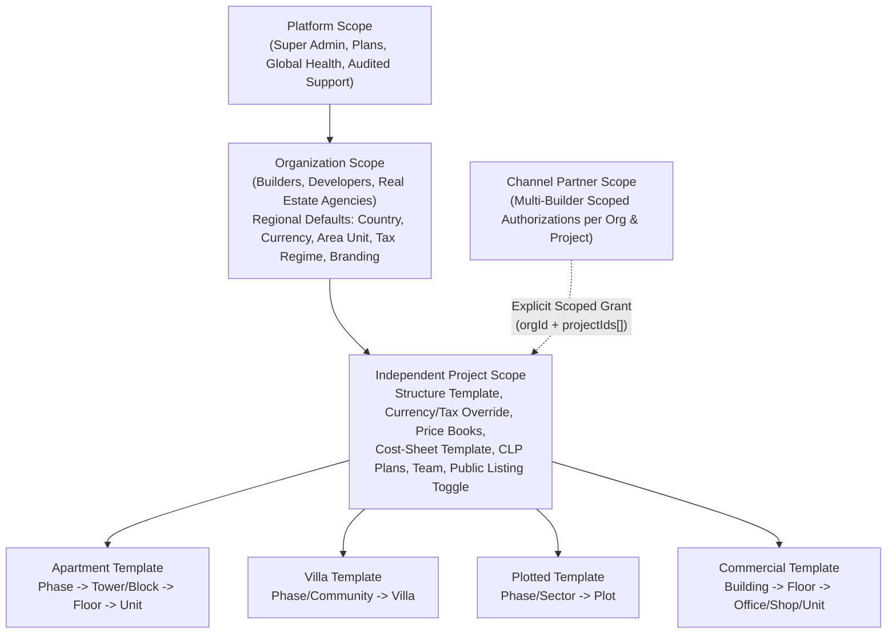

# Bharat Makaan — Global Multi-Project & Multi-Region Data Model

## 1. Three-Tier Governance Hierarchy

---

## 2. Core Schema Enhancements (Additive & Backward-Compatible)

All schema extensions preserve existing fields so previously stored records continue working without data loss.

### A. `organizations/{orgId}`
- **Added Global Fields**:
  - `organizationType`: `'BUILDER' | 'DEVELOPER' | 'REAL_ESTATE_AGENCY' | 'ENTERPRISE_GROUP'` (default `'BUILDER'`)
  - `countryCode`: ISO-3166-1 alpha-2 (e.g. `'IN'`, `'AE'`, `'US'`, `'GB'`, `'SG'`, `'AU'`)
  - `stateOrRegion`: `string` (e.g. `'Karnataka'`, `'Dubai'`, `'Texas'`, `'Greater London'`)
  - `defaultCurrency`: ISO-4217 code (`'INR' | 'USD' | 'AED' | 'GBP' | 'EUR' | 'SGD' | 'AUD' | 'CAD' | 'JPY' | 'KWD'`)
  - `defaultAreaUnit`: `'SQFT' | 'SQM' | 'SQYD' | 'ACRE' | 'HECTARE'`
  - `defaultTimezone`: IANA timezone (e.g. `'Asia/Kolkata'`, `'Asia/Dubai'`, `'America/New_York'`, `'Europe/London'`)
  - `taxRegime`: `{ primaryTaxLabel: string; primaryTaxRatePct: number; secondaryTaxLabel?: string; secondaryTaxRatePct?: number; taxIdLabel: string; taxIdValue?: string }`
  - `regulatoryConfig`: `{ authorityLabel: string; registrationNumber?: string }`
  - `branding`: `{ primaryColor?: string; logoUrl?: string; quotationHeaderNote?: string; quotationFooterNote?: string }`
  - `defaultPricingDefaults`: Organization-level Level-1 pricing inheritance baseline.

### B. `projects/{projectId}`
- **Added Independent Project Fields**:
  - `countryCode`: `string` (inherits org default or overrides for cross-border developers!)
  - `stateOrRegion`: `string`
  - `currencyCode`: `string` (minor-unit aware per project!)
  - `areaUnit`: `'SQFT' | 'SQM' | 'SQYD' | 'ACRE' | 'HECTARE'`
  - `timezone`: `string`
  - `projectType`: `'APARTMENT' | 'VILLA' | 'PLOTTED' | 'COMMERCIAL' | 'OFFICE' | 'RETAIL' | 'MIXED' | 'RESALE_PORTFOLIO' | 'RENTAL_PORTFOLIO'`
  - `structureTemplate`: `'APARTMENT_TOWER' | 'VILLA_COMMUNITY' | 'PLOTTED_LAYOUT' | 'COMMERCIAL_BUILDING' | 'CUSTOM_HIERARCHY'`
  - `hierarchyLabels`: `{ phaseLabel: string; structureLabel: string; levelLabel?: string; unitLabel: string }` (e.g., `{ phaseLabel: 'Community', structureLabel: 'Cluster', unitLabel: 'Villa' }` or `{ phaseLabel: 'Campus', structureLabel: 'Building', levelLabel: 'Floor', unitLabel: 'Office Suite' }`)
  - `regulatoryAuthorityLabel`: `string` (e.g. `'RERA'`, `'DLD'`, `'Exempt'`)
  - `defaultCostSheetTemplateId`: `string | null` (project-specific quotation template)
  - `activePriceBookId`: `string | null`

### C. `towers/{structureId}` (Generalized Structure Entity)
- Represents any mid-tier physical structure (`TOWER`, `BLOCK`, `BUILDING`, `SECTOR`, `COMMUNITY`, `VILLA_CLUSTER`, `RETAIL_WING`) linked to `orgId`, `projectId`, and optional `phaseId`.
- Optional for direct `VILLA_COMMUNITY` and `PLOTTED_LAYOUT` projects.

### D. `units/{unitId}`
- **Added Flexible Inventory Fields**:
  - `unitType`: `'APARTMENT' | 'PENTHOUSE' | 'INDEPENDENT_HOUSE' | 'VILLA' | 'PLOT' | 'COMMERCIAL_UNIT' | 'SHOP' | 'RETAIL_SPACE' | 'OFFICE'`
  - `inventorySource`: `'PRIMARY_DEVELOPER' | 'RESALE' | 'RENTAL_MANAGED'`
  - `listingMode`: `'BUY' | 'RENT' | 'LEASE'`
  - `currencyCode`: `string`
  - `areaUnit`: `AreaMeasurementUnit`
  - `primaryArea`: `number` (in `areaUnit`, synced with `saleableAreaSqft` for backward compatibility)
  - `secondaryArea`: `number` (carpet/net internal area in `areaUnit`)
  - `pricingMode`: `'PER_AREA' | 'BASE_UNIT_PRICE'`
  - `baseUnitPriceMinor` / `calculatedTotalMinor`: Exact integer minor units (`amount * 10^minorUnitDigits`) preventing floating-point drift across currencies!

### E. `price_books/{priceBookId}` & `pricing_overrides/{overrideId}` (6-Level Inheritance)
- Supports scoped overrides at:
  1. `ORGANIZATION` (`orgId`)
  2. `PROJECT` (`orgId` + `projectId`)
  3. `PHASE` (`phaseId`)
  4. `STRUCTURE` (`towerId` — tower, block, or building)
  5. `UNIT_TYPE` (`unitType` / `bhk`)
  6. `UNIT` (`unitId` — individual unit price/rate/premium override)
- **Configurable Regional Tax Rules**:
  - `currencyCode`, `areaUnit`, `basePricingMode` (`'PER_AREA' | 'LUMP_SUM'`)
  - `taxLabels`: `{ primaryLabel: string; secondaryLabel: string; exemptLabel: string }` (defaults to regional tax e.g. `VAT`, `Sales Tax`, or `GST` — never hardcoded!)
  - `offers`: `PricingOffer[]` (structured time-bound or campaign offers such as floor-rise waiver, parking waiver, percentage rebate, or fixed discount).

### F. `cost_sheet_templates/{templateId}` (NEW Core Entity — #37)
- Organization-owned, project-selectable quotation layout & branding templates:
  - `id`, `orgId`, `projectId` (`null` for reusable org template, or project-scoped)
  - `name`, `isDefault`, `status` (`'DRAFT' | 'APPROVED' | 'ARCHIVED'`)
  - `headerConfig`: `{ showLogo: boolean; logoUrl?: string; titleText: string; subtitleText?: string; accentHex: string }`
  - `sectionVisibility`: `{ showCustomerBlock: boolean; showUnitSpecs: boolean; showAreaBreakdown: boolean; showFloorPlanRef: boolean; showParkingBreakdown: boolean; showTaxBreakdown: boolean; showPaymentSchedule: boolean; showSalesRep: boolean }`
  - `labelOverrides`: `Record<string, string>` (per-template custom line-item labels)
  - `customCharges`: `CostSheetLineItemRule[]`
  - `termsAndConditions`: `string`
  - `footerConfig`: `{ disclaimerText: string; signatoryLabel: string; brandFooterText?: string }`

---

## 3. Non-Destructive Compatibility & Migration Guarantees

1. **Zero Deletion**: All 36 existing collections and document IDs remain intact; `cost_sheet_templates` and `pricing_overrides` are added cleanly.
2. **Dual-Read Fallbacks**: Shared domain helpers normalize legacy documents missing `countryCode`/`currencyCode`/`areaUnit`/`structureTemplate` on read (defaulting legacy records to their original `INR` / `SQFT` / `APARTMENT_TOWER` values without forcing new organizations into Indian defaults).
3. **Idempotent Backfill Script**: `scripts/migrate-multi-project-schema.ts` scans existing Firestore documents in batches and populates missing regional/template metadata safely via `merge: true` without overwriting any existing business values.
